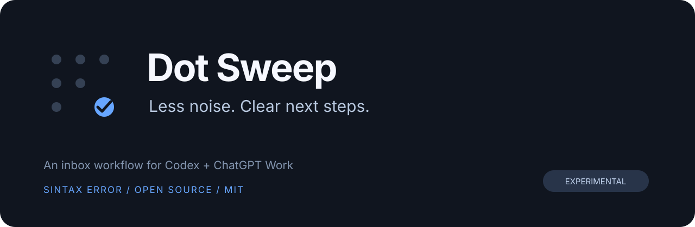

# Dot Sweep

**Less noise. Clear next steps.**

[MIT licensed](LICENSE) · [Report a bug](https://github.com/sintaxerrorpvtltd/dot-sweep/issues) · [Test scenarios](tests/acceptance.md)

An open-source Codex / ChatGPT Work plugin by Sintax Error Private Limited for the hundred-blue-dots problem.

**Status: experimental, not yet verified in a live desktop session.** Packaging checks pass; the desktop host's task-list tool failed during initial testing. This is a review-and-clear skill, not a native colour-changing extension.

Ask once instead of opening every chat:

> Review my unread agent updates. Show what needs me, finished work, coordination only, and running work.

> Clear reviewed coordination updates. Keep questions, approvals, failures, and uncertain updates unread.

## What this version does

| Your inbox contains | Dot Sweep's review |
| --- | --- |
| Questions, approvals, failures | **Needs you** — keep visible |
| Reviewed work with a supported completion result | **Finished** — clear when requested |
| Proven coordination with no outstanding action | **Coordination only** — clear when requested |
| Active work | **Running** — leave alone |
| Missing evidence or unclear status | **Uncertain** — leave unread |

These are digest categories, not changes to the native sidebar colours.

Packages a skill that uses the desktop app's existing thread-list, thread-read, and read-state tools. It produces a grouped digest and performs explicitly requested bulk clearing, with refresh-before-write checks and per-item results. No server, dependency install, API key, or telemetry is included.

It does **not** change native dot colours, install a sidebar widget, detect every agent message automatically, or provide an unattended watcher. A generic MCP server cannot manufacture access to the app's private inbox. If the host does not expose working thread tools, this plugin cannot clear dots.

## Install

**Mac quick start:** clone or download this repository, then run `Install-Dot-Sweep.command` from the checkout. It uses your existing official Codex CLI and its supported plugin installer. No administrator access, shell-profile edits, or downloaded install script. Review the short script before running it.

Requires a desktop host exposing working `list_threads`, `read_thread`, and `set_thread_read_state` tools. Installing this skill does not grant those capabilities. Standard CLI-only environments may not have them.

For a Codex CLI exposing `plugin marketplace` and `plugin add`:

```sh
codex plugin marketplace add https://github.com/sintaxerrorpvtltd/dot-sweep.git
codex plugin add dot-sweep@sintax-error
```

Then start a new chat so the skill catalog can refresh. Ask: **“Use Dot Sweep to review my unread updates. Do not clear anything.”** If the host tools fail, stop there; no inbox state should change.

If an automated session reports `Operation not permitted` while updating Codex configuration, run the installer yourself in Terminal. It has not installed successfully until `codex plugin add` reports success. Do not disable app protections to make installation work.

Remove with `codex plugin remove dot-sweep@sintax-error` (check your CLI's `plugin remove --help` if it uses a different selector).

Add this repository as a local/plugin marketplace using your client's supported plugin manager and select Dot Sweep. The marketplace catalog is `.agents/plugins/marketplace.json`. Install is client-specific; no universal CLI command is assumed.

For clients with skill loading but no marketplace support, place `skills/dot-sweep` in their supported skills directory. Thread-management tools must still be provided by the desktop host. Reload the client's skills and invoke `$dot-sweep` or ask to review unread agent updates.

## Limits worth knowing

- No reliable provenance means no automatic "coordination only" classification.
- Idle/turn-complete is not proof that the underlying task finished.
- Listing may be bounded; the digest must disclose incomplete coverage.
- New messages can race the read-state write because no atomic version guard is exposed.
- ChatGPT read states are window-local and reset across app restarts.
- Undo restores unread flags only. No chat content is changed.

## Validation and contributions

Run `python3 scripts/check_package.py`. This checks packaging, not host integration. Exercise the scenarios in `tests/acceptance.md` on a compatible desktop client before calling the clearing workflow verified.

Contributions welcome via issues and pull requests. Use synthetic examples; do not upload private chat exports, IDs, or account credentials.

MIT licensed. Unofficial; not affiliated with OpenAI.

Built by **Sintax Error Private Limited**. Contributions should keep the core small: readable evidence, explicit clearing, no silent loss of important updates.
